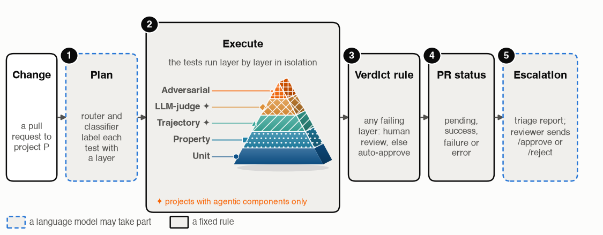

# Cloudera Blueprint: Agentic QA

[](https://github.com/masorg)
[](LICENSE)
[](pyproject.toml)
[](METADATA.yaml)
[](https://github.com/masorg/blueprint-agenticqa/stargazers)
[](https://github.com/masorg/blueprint-agenticqa/network/members)

Agentic QA is a testing-pyramid quality gate for pull requests. It runs as one Cloudera AI application: a pull request opens, the app selects the pyramid layers that apply, runs those tests, writes a triage report, and either auto-approves or holds the change for a person. The verdict is a fixed rule. A language model may route, classify, and draft the report. It does not approve the merge.

<p align="center">
  
</p>

## Table of Contents

- [Overview](#overview)
- [Demo](#demo)
- [Use Case](#use-case)
- [Key Features](#key-features)
- [Quickstart](#quickstart)
- [Architecture / Software Components](#architecture)
- [Target Audience](#target-audience)
- [Repository Structure](#repository-structure)
- [Prerequisites](#prerequisites)
- [Hardware Requirements](#hardware-requirements)
- [Documentation](#documentation)

## Overview

Agentic QA gives platform and application teams a merge check that runs on Cloudera AI, next to the models and repositories they already operate. It watches pull requests, runs the tests that apply to the change, and posts an `agentic-qa/review` commit status. Plain services use the unit, property, and adversarial layers. Agentic systems also use trajectory and LLM-as-judge. Missing evidence or a failing layer goes to a reviewer instead of a green check.

## Demo

A public Reprise walkthrough is not published yet. Run the local dashboard (see [Quickstart](#quickstart)) or follow the recording script in [`docs/demo-script.md`](docs/demo-script.md). The script walks a clean change to auto-approve, a regression to human review, and an agent change that turns on the two agent-only layers.

Two local targets are included:

```bash
.venv/bin/agenticqa run-local --path demo/inventory-orders-api          # clean service → auto-approve
.venv/bin/agenticqa run-local --path demo/inventory-orders-api --bug    # regression → needs review
.venv/bin/agenticqa run-local --path demo/support-assistant             # agentic system → extra layers
```

## Use Case

Pull requests from people and coding agents arrive faster than a full test suite can be run on every change, and a model-written review is not a test result. Agentic QA selects and runs the tests that bear on the diff, then withholds approval when a selected test fails, when changed code is not reached by those tests, or when the diff removes or weakens tests. The business outcome is a recorded test basis for each merge decision, with a person in the loop when that basis is incomplete.

## Key Features

- Five-layer testing pyramid. Trajectory and LLM-as-judge apply only when the system under test is itself an agent.
- Deterministic verdict. Models can suggest tests and write the triage report. They cannot flip a failure or missing evidence into an approval.
- GitHub-native gate. One organization webhook covers current and future repositories. The app posts the `agentic-qa/review` status, and a reviewer with write access comments `/approve` or `/reject`.
- Runs without a model key. Routing, classification, and triage fall back to heuristics. GitHub statuses are skipped, and logged, when no token is set.
- Cloudera AI application. One Python process, bound to `CDSW_APP_PORT`, with optional calls to Cloudera AI Inference.

## Quickstart

<a id="quickstart"></a>

### Local

From the repository root, with Python 3.11 or newer:

```bash
python -m venv .venv
.venv/bin/pip install -e .
AGENTICQA_SEED_SAMPLES=1 AGENTICQA_LLM_PROVIDER=stub \
  .venv/bin/agenticqa serve --host 127.0.0.1 --port 8000
```

Open http://127.0.0.1:8000. The dashboard loads sample runs. `stub` keeps triage on this machine. To use a real model, copy [`.env.example`](.env.example) to `.env` and set `AGENTICQA_LLM_PROVIDER` to `openai`, `mistral`, or `cloudera`.

`conda env create -f environment.yml` is an alternative. It creates an `agenticqa` environment on Python 3.13. Then run the same `agenticqa serve` command with that environment's Python.

### Cloudera AI

The application script is [`app.py`](app.py). Full project, webhook, and environment-variable steps are in [`docs/deploy-cai.md`](docs/deploy-cai.md). For a private GitHub remote, create the project from a blank Cloudera AI project, then fetch in a session terminal:

```bash
git init
git remote add origin https://github.com/masorg/blueprint-agenticqa.git
git fetch origin
git checkout -f -t origin/main
```

Use a fine-grained personal access token with Contents read as the Git password. Then create an Application with script `app.py`, Python 3.11 or newer, and the variables in Part 6 of the deploy guide.

## Architecture / Software Components

<a id="architecture"></a>

A pull request arrives over a GitHub webhook. The app checks out the change, selects tests, runs each pyramid layer in an isolated virtualenv, applies the verdict rule, posts a commit status, and, when evidence is missing or a layer fails, writes a triage report for a reviewer.


| Component | Role |
| --- | --- |
| FastAPI app (`src/agenticqa`) | Dashboard, webhook API, run engine. One worker, because the event bus and store are in-process. |
| Pytest runner | Discovers and runs unit, property, adversarial, trajectory, and LLM-as-judge tests. |
| Executor | Per-run virtualenv. On Cloudera AI it clears inherited `PIP_USER` so installs inside the venv succeed. |
| LLM client | OpenAI, Mistral, or Cloudera AI Inference. Unused when `AGENTICQA_LLM_PROVIDER=stub`. |
| GitHub integration | Organization webhook plus a bot token, or a GitHub App. Allowlists limit which orgs the app acts on. |
| Demo systems | `demo/inventory-orders-api` (plain service) and `demo/support-assistant` (agent). |

## Target Audience

- Platform and ML engineers who run Cloudera AI and want a pull-request gate beside existing repositories.
- Application teams shipping services or tool-calling agents who need a recorded test basis before merge.
- Solution architects evaluating a launchable quality-gate blueprint for a lab or a customer workspace.

## Repository Structure

| Path | Description |
| --- | --- |
| `METADATA.yaml` | Catalog metadata for the Cloudera blueprint website |
| `assets/` | Architecture diagram |
| `app.py` | Cloudera AI application entry point. Select this as the Application script. |
| `cml/` | Shell entry point for a non-CAI process that must bind `CDSW_APP_PORT` |
| `src/agenticqa/` | Application package: API, orchestrator, runners, GitHub, dashboard |
| `demo/` | Systems under test used by the local demo and evaluation corpus |
| `github-integration/` | Per-repository GitHub Actions templates, for private or VPC deploys |
| `docs/` | Deploy guide, webhook setup, demo script, and the paper |
| `tests/` | Tests for Agentic QA itself |
| `eval/` | Evaluation reports |

## Prerequisites

- Python 3.11 or newer for a local run. On Cloudera AI, an ML Runtime with Python 3.11 or newer (3.12 is fine).
- Git, and access to this private repository (`https://github.com/masorg/agentic-qa`).
- For a live GitHub gate: a bot token or GitHub App, an organization webhook secret, and workspace egress to `github.com` and `api.github.com`.
- For model-written triage: an OpenAI key, a Mistral key, or a Cloudera AI Inference endpoint. Omit all three to use the stub.
- For the webhook to reach a Cloudera AI application: an admin must allow unauthenticated applications, and this application must enable unauthenticated access. Requests are still checked with the webhook HMAC and a GitHub write-access check on approval.

## Hardware Requirements

| Deployment | Minimum |
| --- | --- |
| Local demo | A laptop with Python 3.11+, about 2 GB free RAM for the app and one pytest run |
| Cloudera AI application | 2 vCPU / 4 GB. The deploy guide uses this floor because the app builds virtualenvs and runs pytest. |
| Reference workspace used in evaluation | 16 vCPU / 16 GB on an AWS-hosted Cloudera AI workspace |

## Documentation

- [Deploy on Cloudera AI](docs/deploy-cai.md)
- [Organization webhook setup](docs/11-org-webhook-integration.md)
- [GitHub App setup](docs/10-github-app-integration.md)
- [Demo recording script](docs/demo-script.md)
- [Lessons from a real Cloudera AI deployment](docs/14-production-lessons.md)

## License

Licensed under the [Apache License 2.0](LICENSE).
