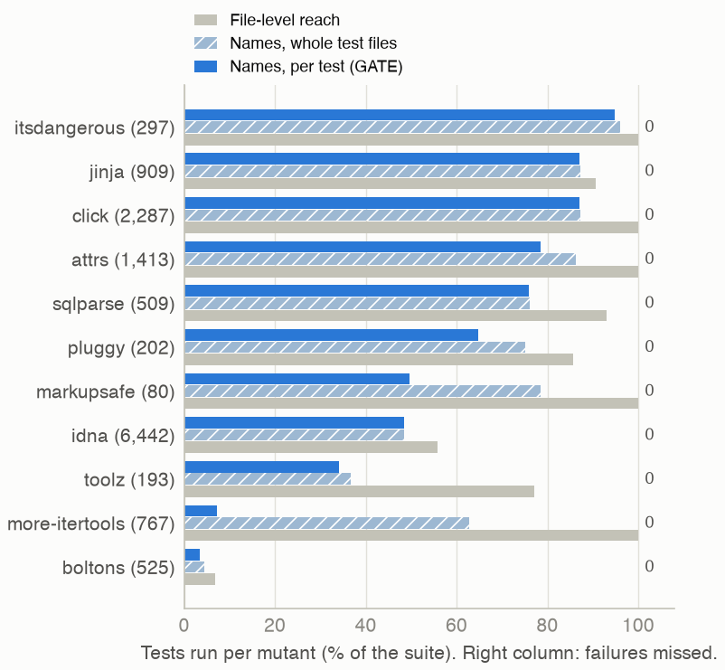

<!--
DRAFT for CAIN 2027, AI Engineering in Practice track (10+2 pages, IEEE template).
Every double-brace placeholder is filled from the committed evidence by build_draft.py
(numbers come from docs/figures/numbers.tex and eval/reports/*.json). Do not type numbers here.
Items in [AUTHOR: ...] need a decision or a fact only the authors have.
-->

# Models Assist, Test Evidence Decides: A Merge Gate for AI-Generated Pull Requests

**Authors:** [AUTHOR: names, affiliations, emails]

## Abstract

AI coding agents open pull requests faster than people can review them, so merging has become the bottleneck. The obvious answers fail: a language model that approves changes can be talked into approving unsafe ones, and running every test for every change does not scale. Test selection cuts the cost but opens a gap, because a gate that trusts its list of selected tests approves whatever the list omits. We present GATE (Guarded Approval from Test Evidence), a merge gate built on one rule: never approve on silence, that is, never when no executed test speaks to part of the change. A deterministic core selects the tests a change can affect, statically or from a stored coverage recording, and runs every test when unsure. Models may add tests, label them, and explain results, but they cannot remove a test or alter the verdict. A change that no selected test reaches, or that removes tests, goes to a person. We evaluate GATE against a full test run on 215 + 189 failing mutants of 22 Python projects (half of them pre-registered held-out projects), 162 real SWE-bench defects, and 829 replayed real pull requests. GATE missed no failure, including all 13 cases in which its selection had omitted the failing test. On the same mutants pytest-testmon missed 10 of 404 failures, and in a misleading-text attack a model that decided pass or fail approved 5.4% of failing runs, where GATE approved none. On 347 real pull requests GATE ran 33.8% (static) to 45.6% (stored coverage recording) fewer tests, and across 829 it sent only 5.6% of the pull requests that a full run passed to a person. Hostile routers, classifiers, advisors, and pull-request text changed no verdict. Building and attacking GATE exposed nine fail-open defects in our own code, from which we draw four lessons for pipelines that put a model beside a decision.

**Index Terms:** pull-request review, regression test selection, LLM agents, merge gates, AI engineering

---

## 1. Introduction

AI coding agents have changed how many pull requests are opened. The AIDev dataset holds over 456,000 pull requests from five agents [1]. GitHub reports 43.2 million merged pull requests per month in 2025, 23% more than in 2024 [2], and vendor telemetry from over 10,000 developers shows that teams with high AI adoption merged 98% more pull requests while review time grew by 91% [3]. Producing a change is no longer the bottleneck. Merging it is [3, 4].

A merge needs evidence that the change does not break the project, and each of the common sources of that evidence has a weakness. A language model can review and approve, but review agents decide sooner without reviewing better [5], and the text of a pull request can talk them into approving unsafe code [6]. A person can review, but reviewers approve AI-written code more often as they see more of it [7]. Test results do not depend on how persuasive a pull-request description is or how tired a reviewer is, but running every test for every change spends the most compute where changes are most numerous. Regression test selection lowers that cost by running only the tests that a change can affect [8 to 11].

Selection moves the risk instead of removing it. A gate that consumes the list of selected tests treats an empty or incomplete list as good news: the test that would have failed is never run, and the check is green. Safe selection tools fall back to a full run for changes they cannot analyse [9, 12], but within what they can analyse they trust their own list, and a patch-coverage check [13] measures the coverage of the whole suite, not of the tests that ran. Agents add a second route to a green check, because they can delete or skip the test that would fail [14].

This paper takes the position that a merge gate must *never approve on silence*. Silence is any lack of evidence: a changed file that no selected test reaches (imports, or executes under a recording), or a change that removes the tests that would speak. GATE (Guarded Approval from Test Evidence) applies the rule in three steps. A deterministic core selects the tests that a change can affect, from static dependencies or from a per-test coverage recording, made once and reused (*stored*) or made again for each change (*fresh*), and runs every test when it cannot account for the change. Language models may add tests, label them with a layer of a test pyramid, and write the report for the reviewer, but they can never remove a test or weaken the verdict. A fixed rule then computes the verdict: any failing test, any changed file that no selected test reaches, and any removed or weakened test sends the change to a person with write access, and everything else is approved. People remain the last step, but they see only the changes that the evidence cannot clear, together with the reason.

GATE is an AI-engineering artefact in two senses. It is a quality gate for software built with coding agents, including software with agentic components, for which its pyramid adds layers for tool-call trajectories and LLM-judged answers. And it is itself an AI-enabled system whose models may assist but are never trusted. Its design answers the question every team faces when it puts a language model into a delivery pipeline: what may the model decide? In GATE the answer is nothing; the model proposes, labels, and explains, and a deterministic rule decides. Models improve grouping and explanation; they are not needed for safety, which is the point.

Vendors whose software enterprise customers run in production, and those customers, including regulated enterprises, share five requirements that follow from this problem and from our own practice of building and operating the gate: throughput (R1), accountability for each decision (R2), safety against the change itself (R3), independence from any particular model (R4), and gradual adoption (R5). Table II defines them and maps each to a mechanism and to evidence (Section 3.7); they are our analysis, not a survey. GATE decides the test step of a merge, not the whole review: an organisation that requires human code review keeps it, and GATE tells the reviewer whether the tests show the change safe.

We evaluate GATE against a full test run, which is what a plain CI check does, on mutants of 22 Python projects, on real defects, and on a replay of real pull requests in sandboxes. GATE missed none of the failures that the full run showed, and it did not depend on its selection to achieve this: in 13 cases the static selection contained no failing test, and the rule for unreached changes escalated every one of them. On the same mutants pytest-testmon, a widely used selection tool, missed 10 of 404 failures. A model that decides pass or fail from the same inputs as the gate approved 5.4% of failing runs under misleading text, and GATE approved none. The contributions are the following.

1. **A merge gate that models cannot talk into approving (Section 3).** GATE separates what models may do (add tests, label them, explain the outcome) from what decides (a fixed rule over the selected tests, the unreached part of the change, and the tests it removes). A proposition states that no router, classifier, or test advisor can weaken the verdict, under two stated assumptions. A pyramid of five failure-class layers, two of them for agentic components, structures the reports and can be extended.
2. **No missed failure, including every case where the selection failed (Sections 5.1 and 5.2).** GATE missed none of the 215 development and 189 held-out failing mutants or of the 26 regressions in 829 real pull requests, and its static check selected or escalated all 162 real defects. In 13 of these cases the static selection omitted the failing test, GATE caught 13 of 13, and a plain selection gate would have approved all of them. Of the regressions, 4 depended on the selection. pytest-testmon missed 10 of 404 failures on the same mutants.
3. **Large savings at a small review cost (Section 5.2).** On 347 pull requests the static core saved 33.8% of the tests, and a coverage recording reused for up to 140 commits saved 45.6%, as much as a fresh recording for every change (45.7%). Across 829 pull requests GATE sent 5.6% of those that a full run passed to a person, and a labelled sample shows which escalations were warranted.
4. **Three kinds of ground truth and a reusable evaluation kit (Section 4).** The evaluation combines mutants of 22 projects, half of them pre-registered held-out projects, real defects, and 1,100 pre-registered real pull requests replayed in sandboxes. The replay harness, the pull-request manifests, the hostile-component tests, and the labelled escalations are released with the paper, and the replay runs in shadow mode on an organisation's own history (R5).
5. **Lessons from attacking and deploying the gate (Sections 5.3 and 6).** Hostile routers, classifiers, advisors, and misleading pull-request text changed no verdict after the two defects they exposed were fixed. The experiments exposed nine fail-open defects in our own gate, and deploying an earlier version on a managed platform exposed failures that hide a gate's output. We report the practices that found them.

---

## 2. Related Work

**Review load and LLM reviewers.** Agent-written pull requests are numerous [1, 2] and make review a growing bottleneck [3, 4]. Over a million reviewed pull requests show that agents speed up decisions without improving review quality [5]; review agents can be manipulated by pull-request text [6], artificial benchmarks flatter them [15], and human reviewers alone are not a safe backstop [7, 16]. GATE treats pull-request text as attacker-written.

**Regression test selection.** Choosing the tests that a change can affect is a long-studied problem. Safe techniques select every test whose behaviour can change [8]. Ekstazi tracks dynamic file dependencies [9], and Legunsen et al. compare static techniques [10]. Industrial systems trade safety for cost with models trained on history [17, 18]. For Python, NameRTS builds a graph of code names and selects all affected tests for 99.6% of commits while skipping 69.9% of test files on average [11]. pytest-testmon records per-test dependencies with coverage and reruns the tests whose code changed [19]; Section 5.1 compares it with GATE on the same mutants. For agents, TDAD gives the coding agent a test-impact map [20], and CASPER ranks slices of an LLM system's tests by their chance of regressing [21]. GATE's static core belongs to the family of safe static selection with name-level analysis, and its coverage-based core to dynamic selection. It claims no better selection algorithm.

**Selection and coverage in CI practice.** Industrial CI already combines some of GATE's parts: Test Impact Analysis in Azure Pipelines selects impacted tests and falls back to all tests for changes it cannot analyse, such as unknown file types [12]; build systems at scale run the tests of affected targets [18]. Patch-coverage checks such as diff-cover fail a build when too few changed lines are covered by the suite [13]. They measure coverage by the whole suite, not by the tests that ran for the change, and they do not consider removed tests or the role of models. Agents can also pass a check by changing the tests: on tasks whose tests contradict the specification, frontier models modify or special-case tests instead of failing [14].

**Testing LLM and agent systems.** Two recent papers propose test pyramids for these systems: Badagi et al. [22] define five layers by the scope of what is tested and gate deployment with thresholds on LLM-judge scores, and Kohl et al. [23] apply the unit, integration, and acceptance pyramid to LLM-based agents in two case studies. Neither selects tests for a change or asks a person to approve one. GATE defines its layers by the kind of failure they find and includes a property-based layer, since mixing property-based with example-based tests finds more bugs [24, 25]. Work on making agents write tests [26 to 30] is a different problem, since GATE uses the tests a project has, and generated tests are often shallow or flaky [31, 32]; work on judging agent trajectories [33, 34] relates to the trajectory layer.

**How GATE differs.** The works above supply parts of GATE, and none supplies the whole. Safe selection [8 to 12, 17 to 19] decides which tests run and trusts its own list; patch coverage [13] checks the whole suite's coverage, not the selected run's. The LLM-based works use a model to inform an agent [20] or to rank tests [21], not to extend a safe core, and LLM reviewers [5, 6] let a model decide. The pyramid papers [22, 23] provide layers, not selection or approval. GATE's contribution is the combination and its tested safety: a deterministic core fixes the tests that must run, models may add tests and cannot remove any (Proposition 1), a changed file that no *selected* test reaches goes to a person, and so does a change that removes or weakens tests, which no selection tool or coverage check considers. A fixed rule turns the outcomes into a status that only a person with repository permission can override.

---

## 3. The GATE Framework

GATE (Guarded Approval from Test Evidence) decides whether the tests of a project show a change safe to merge. It uses the tests that the project holds at the changed commit, whether people or agents wrote them, and applies to projects with or without agentic components, including hybrid ones. GATE has two parts (Figure 1): a *test pyramid*, which groups the tests into five layers by the class of failure they target, and a *review pipeline* of five stages:

1. **Select and plan.** A deterministic selector chooses the tests that must run. A router and a classifier, which may be language models, decide which layers the change calls for and which layer each test belongs to. A test advisor, which may also be a model, can add tests and cannot remove any.
2. **Execute.** An isolated executor runs the selected tests layer by layer.
3. **Verdict rule.** A fixed rule maps the outcomes, whether every changed file is reached by a selected test, and whether the change removes tests, to `auto_approve` or `needs_human_review`. No model takes part.
4. **Status.** The verdict is published as a commit status, which a repository can require before merging.
5. **Escalation.** A flagged change goes to a reviewer with a triage report, which a model may draft; the reviewer resolves it with `/approve` or `/reject`.


Formally, GATE maps a change $c = (\Delta, m)$, a diff $\Delta$ with its description $m$ (commit message and pull-request text), of a project $P$ to a verdict $V$:
$$\begin{aligned} T &= \mathrm{discover}(P_c), & E &= \mathrm{select}(c, T), & \pi &= \mathrm{plan}(c, E),\\ o &= \mathrm{execute}(E, \pi), & V &= \mathrm{decide}(o, c). \end{aligned}$$
$P_c$ is the project after the diff, $T$ its discovered tests, and $E \subseteq T$ the selected tests. The plan $\pi = (R, \lambda)$ consists of the layers $R \subseteq L$ that the change calls for and a labelling $\lambda : E \to L$ onto the layers $L = (\ell_1, \dots, \ell_5)$ of the pyramid. Each selected test gets an outcome $o(t) \in \{\text{pass}, \text{fail}, \text{error}\}$; a test without a result, or whose run is cut short by a limit, is an error, and a layer is *bad* if one of its tests fails or errors. Algorithm 1 gives the procedure; the number before a step names its stage.

```{=latex}
\begin{algorithm}[!ht]
\caption{GATE on a change $c = (\Delta, m)$ of a project $P$}
\begin{algorithmic}[1]
\State check out $P_c$ and discover the tests $T$ \Comment{error if this fails}
\State \textbf{(1)} $E_0 \gets \textsc{Core}(\Delta, T)$ \Comment{all of $T$ if the analysis fails}
\State \textbf{(1)} $E \gets E_0 \cup (\textsc{Advise}(c, T) \cap T)$
\State \textbf{(1)} $R \gets \textsc{Router}(\Delta, m)$;\quad $\lambda_0 \gets \textsc{Classifier}(E)$
\State \textbf{(1)} $\lambda \gets \textsc{Reconcile}(\lambda_0, E, R)$
\For{each layer $\ell \in L$ in pyramid order}
  \State \textbf{(2)} execute the tests $\lambda^{-1}(\ell)$ in isolation; record $o(t)$
\EndFor
\State \textbf{(3)} $A \gets R \cup \lambda(E)$;\quad $U \gets \textsc{Unreached}(\Delta, E_0)$;\quad $W \gets \textsc{Weakened}(\Delta)$
\State \textbf{(3)} $V \gets$ \texttt{needs\_human\_review} \textbf{if} some layer in $A$ is bad \textbf{or} $U \cup W \neq \emptyset$ \textbf{else} \texttt{auto\_approve}
\State \textbf{(4)} publish $V$ as the status of $c$
\State \textbf{(5)} $n \gets \textsc{Triage}(c, o)$; post $n$ on $c$
\If{$V$ is \texttt{needs\_human\_review}}
  \State \textbf{(5)} wait for \texttt{/approve} or \texttt{/reject} from a user with write access
\EndIf
\end{algorithmic}
\end{algorithm}
```

If a model fails or returns unusable output, a rule takes its place; if the tests cannot be discovered, the run ends in `error`; if the selection cannot be computed, every test runs. None of these produces an approval that a full run would not.

*Example.* In a tool-calling support assistant, a change to the function in `planner.py` that orders tool calls selects only the two tests that mention it; the trajectory test fails, and the change goes to a reviewer with a report naming it. Had the change edited a function of `refund.py` that no test calls, nothing would fail, but $U(c)$ would hold `refund.py`, and the change would still go to a reviewer, where a plain check would be green.

### 3.1 Test Pyramid

The pyramid groups the tests of a project into five layers, each defined by the class of failure it targets rather than by the size of the unit under test (Table I). A layer is a triple of a failure class, the projects it applies to (all, or only those with agentic components), and *cues* matched against a test's path, name, and markers; a test that matches several layers goes to the one nearest the apex, and a test that matches none is a unit test. A conventional project is judged on three layers and a project with agentic components, including a hybrid one, on five. The layers structure the plan and the report. They never change which tests run, and they enter the verdict only through the rule that a failing test fails its layer.

**Table 1.** The layers of the GATE pyramid, from the base to the apex. The cues are matched against the path, name, and markers of a test.

| Layer | Failure class $\varphi$ | Applies to $\alpha$ | Cues $\psi$ |
|---|---|---|---|
| Unit | Incorrect results for individual inputs | all projects | none (default) |
| Property | Violated invariants over generated inputs or sequences of steps | all projects | property, hypothesis, invariant |
| Trajectory | Wrong tools, or tools called in the wrong order | agentic components | trajectory, tool_sequence, toolseq, agent_trace |
| LLM-judge | Answers not supported by the evidence they were given | agentic components | llm_judge, llm_as_judge, judge, rubric |
| Adversarial | Failures on invalid or hostile input and at limits | all projects | adversarial, security, fuzz, malicious, hostile, injection |

### 3.2 Selection

Selection uses no model. A test file *reaches* every file it imports, directly or transitively, and the `conftest.py` files above it. The *core* $E_0$ is the set of tests that the change can affect; the static core computes it in two steps.

1. *File level.* A test is in the core if its file is changed or reaches a changed file. This is safe but coarse: a package whose `__init__` imports every module makes every test reach every file.
2. *Name level.* For a change inside a function body, the *affected names* are the function and, transitively, every definition whose body mentions an affected name. A test function stays in the core only if it reaches the changed file and mentions an affected name, in its body, decorators, or parameters (and so its fixtures), or in code it shares with other tests (class set-up, module-level code, autouse fixtures, and pytest hooks).

Changes that cannot be expressed as names stay at file level: import-time code, decorators, non-literal defaults, class bodies, unparsable files, and functions called by a string (a dictionary filled at import time, or a prefix passed to `getattr`). Computed imports, loading by path, and started processes reach only modules named by string literals, followed at file level.

*Coverage-based core.* Where a stored recording of the suite exists, made under coverage with per-test contexts, the core of a change inside function bodies is the set of tests that executed those bodies. Three cases keep the static rules, because coverage cannot see what matters there: a body that also ran outside any test (at import or collection), a decorated function, which a decorator can cache or wrap, and code run in another process.

The selection fails closed. An empty or unreadable diff, a change to build or test configuration (`pyproject.toml`, `requirements.txt`, `pytest.ini`), and any error in the analysis select every test. Documentation, images, comments, and docstrings are *inert* and select nothing, unless the runner collects them as doctests.

*Unreached and weakened changes.* Reach is decided per changed file by the rule that built the core: a test of $E_0$ must import the file (file level), mention an affected name of its change (name level), or have executed a changed body (coverage). The changed files that no test of $E_0$ reaches form $U(c)$, the *unreached* part of the change, which no test shows safe; in a project without tests, every changed file that is not inert is unreached. A *scope policy* exempts files that do not ship, by default those under documentation, example, script, benchmark, and tooling directories and data files that no code names; they are reported but do not enter $U(c)$, so an organisation that ships such files must narrow the policy. $U(c)$ depends on the core alone, so advice cannot shrink it. A change can also pass by removing the test that would fail, so $W(c)$ records how the diff takes evidence away: test files deleted, test functions removed, skip or expected-failure markers added, assertions removed, and pytest hooks or options that rewrite or deselect results.

A *test advisor*, a model or a rule matching test names to changed files, may name further tests, for example one that reaches the change through a subprocess or a plugin. Its answer is intersected with the discovered tests and added: $E = E_0 \cup (\mathrm{advice}(c) \cap T)$.

### 3.3 Plan and Execution

A plan $\pi = (R, \lambda)$ states which layers the change calls for and which layer each selected test belongs to. It neither writes nor removes tests. The *router* produces $R$ from the diff, the description, and the repository name: it decides whether the project has agentic components (calls language models or tools, builds prompts, or plans over several steps) and which layers apply; a guard discards agentic layers for a project without such components. The *classifier* labels each selected test from its name, file, and markers. A keyword search over the diff and the cued layer replace the router and the classifier whenever a model fails or returns unusable output, or when no model is configured. A *reconcile* step then gives every selected test exactly one layer: a test that the classifier left out gets its cued layer, names outside $E$ are dropped, and a label outside $R$ is moved to the cued layer or to the unit layer. No selected test is removed at any point.

The tests of a change are part of the change under review, so an *execution policy* fixes the runner, the environment, the limits, and the isolation level. The executor builds one environment per set of declared dependencies and runs each layer in a separate process, under limits and without GATE's credentials; a stricter policy runs everything in a throwaway container with reduced privileges.

### 3.4 Verdict Rule

A layer is *active* if the router selected it or if at least one selected test is labelled with it:
$$A = R \cup \{\lambda(t) : t \in E\}.$$
The verdict rule then maps the outcomes, the unreached part of the change, and the evidence it removes to the verdict:
$$V = \begin{cases} \texttt{needs\_human\_review} & \text{if some layer in } A \text{ is bad, or } U(c) \cup W(c) \neq \emptyset,\\ \texttt{auto\_approve} & \text{otherwise.}\end{cases}$$
A change is approved only if every selected test passes, every changed file that is neither inert nor exempted by the scope policy is reached by one, and no test is taken away. A selected test that already failed before the change also flags it; GATE does not compare against the merge base. The rule is the same for every change and does not consult a model.

Let $V_0$ be the verdict that GATE would give if it ran only the core $E_0$ and activated every layer. We assume (A1) that the outcome of a test does not depend on its layer or on the other tests in the run, and (A2) that a run that does not finish yields an error.

**Proposition 1 (Models cannot weaken the verdict).** Under A1 and A2, for every router, classifier, and advisor, (M1) $E_0 \subseteq E$, (M2) if $V_0$ is `needs_human_review` then so is $V$, and (M3) the labelling $\lambda$ does not change which tests run.

*Proof.* The advice is intersected with $T$ and united with $E_0$ (M1), and the outputs of the router and the classifier never enter $E$ (M3). If a test of $E_0$ fails or errors in $V_0$, it is in $E$, fails or errors there too by A1 and A2, and makes its layer $\lambda(t) \in A$ bad. $U(c)$ and $W(c)$ depend on $\Delta$ and the core alone, so they are the same. $\square$

Because $A$ contains every layer that holds a test, a hostile router cannot hide a failure. A1 fails when tests share state, and an advisor's extra tests could then mask a failure; the attacks of Section 5.3 probe this case, and it lies outside the proof. Two further properties hold by construction. *No approval on silence:* an approved change passed every selected test, and $U(c) = W(c) = \emptyset$. *No missed failure under safe selection:* if every test whose outcome can change is in $E_0$, a newly failing test flags $c$. The second property is only as good as the dependencies behind the core: reflection, shared state, and external services can break them, and one real pull request did (toolz#632, Section 5.2). Hostile test code, a hostile environment, and the triage report are outside these guarantees.

### 3.5 Status and Escalation

GATE publishes $V$ as a commit status: `pending` while a run is in progress or waits for a reviewer, `success` when $V$ is `auto_approve` or a reviewer approves, `failure` when a reviewer rejects, and `error` when a run fails. A reviewer resolves a flagged change by commenting `/approve` or `/reject`. GATE accepts a comment only from a user whose repository role is `admin`, `maintain`, or `write`, as reported by GitHub; no text in a comment, description, or diff confers authority, and every webhook is authenticated by its signature. A *triage report* tells the reviewer which layers ran, which tests failed, and which changed files no test reaches; a model may draft it after $V$ is fixed, and a template replaces the model if it fails.

### 3.6 Implementation and Extension

The selector, router, classifier, advisor, triage writer, executor, and test runner are interfaces, and every model-backed implementation has a rule-based counterpart. The reference implementation is a Python package (`agenticqa`) with pytest as its runner, pytest-cov for recordings, and Docker for isolation (non-root, no capabilities, read-only file system, limits on CPU, memory, and processes). A command line or a GitHub integration drives it: the integration receives pull-request and comment webhooks, runs the pipeline, sets the status, and processes approvals. Settings choose the selected or the full run and name a stored coverage recording, with a fallback to the static core. An organisation adapts GATE by changing a layer, replacing a model through its interface, choosing the execution policy, and setting the approving roles. An earlier version, with the pipeline, the models, and the GitHub integration but before the selector, was deployed as an application on Cloudera AI and gated pull requests of our own test repository end to end (Section 6).

### 3.7 Use in an Organisation

Table II maps the requirements of Section 1 to GATE's mechanisms and to the evidence for them. Adoption follows three modes, which the GitHub integration implements. In *shadow* mode GATE logs its decisions for comparison with the organisation's CI, as Section 5.2 does on public history; in *advisory* mode it posts a status that is not required; in *enforce* mode the status gates the merge. The organisation sets the roles that may approve, the scope policy, and whether to use a stored recording.

**Table 2.** Requirements that we derive for an organisation adopting coding agents (Section 1), and how GATE meets them.

| Requirement | Mechanism | Evidence |
|---|---|---|
| R1 Throughput and safety of selection | Static or coverage-based selection; inert changes need no test | 33.8% (static) and 45.6% (stored) fewer tests on the same real pull requests; 13 selection misses caught as unreached (5.1, 5.2) |
| R2 Accountability | A fixed verdict rule; approval only by repository permission; recorded reasons and triage report; code review policy unchanged | No model takes part in the verdict (3.4); every escalation names its reason |
| R3 Safety against the change | Changes that remove or weaken tests go to a person; text never grants authority; isolated execution | 36 test-removal flags, each reviewable: 2 real weakenings, 18 false positives, mostly one missing exemption for skips on new tests (5.2); misleading text changed no verdict (5.3) |
| R4 Model choice | Every model has a rule-based counterpart; models only add; the selector and the verdict use no model | Plain rules gave the same verdicts as four models (5.3); all safety experiments ran with no model |
| R5 Gradual adoption | Shadow, advisory, and enforce modes | The shadow replay (5.2) is the first step an organisation can run on its own history |

---

## 4. Evaluation Design

We ask five questions.

- **RQ1, safety.** Does GATE miss a failure that a full test run shows?
- **RQ2, cost.** How many tests and how much time does GATE save, and how often does it send a change to a person?
- **RQ3, models.** Can a router, a classifier, a test advisor, or the text of a pull request weaken the verdict, and what do models add over rules?
- **RQ4, alternatives.** How does GATE compare with a widely used selection tool on the same changes?
- **RQ5, layers.** What does the test pyramid add?

The reference throughout is a full test run, which is what a plain CI check does. A *regression* is a test that passes at the merge base and fails with the change. GATE *misses* a regression if it neither selects the failing test nor sends the change to a person. We report misses with the upper end of a 95% Wilson interval, which stays above zero when no miss is observed.

**Data.**

- *Mutants of real projects.* Open-source Python libraries with pytest suites at pinned commits: attrs, boltons, click, idna, itsdangerous, jinja, markupsafe, more-itertools, pluggy, sqlparse, and toolz. A mutant changes one source file in one of seven ways: flip a comparison, swap `+` and `-`, swap `and` and `or`, drop a `not`, replace a `raise` with `pass`, negate an `if` condition, or shift a numeric constant. We drew at most 30 per project, round-robin over source files with a fixed seed, and dropped mutants that break test collection. The full suite either fails on a mutant or does not; mutants on which it does not, including equivalent ones, are survivors and cannot be missed. The selector was developed on these projects.
- *Held-out projects.* We named 22 further projects in three batches and pinned each to its last non-merge commit before 2026-09-30 before running any of them. None was used to develop the selector before its first run; the first run exposed a bug in the static core (in validators, batch 2), and after each fix all held-out projects were rerun. Batch 3 was named after the first fix. The coverage-based core was developed later and was itself fixed after misses on held-out mutants (Table V), so no batch is untouched for it. Only 11 of the 22 could be set up (the others lacked build metadata or test plugins); with the 11 development projects they make the 22 projects of the evaluation.
- *Real defects.* SWE-bench Verified [35] pairs real GitHub issues in 12 projects with the fixing patch and the tests that fail before the fix. We drew at most 20 instances per project with a fixed seed (180 in all, because several projects have fewer), and excluded instances whose exposing tests could not be matched to discovered test functions by name. Each instance becomes a change that introduces the defect (the tree before the fix with the test patch, and the reverse of the fix as the diff), and GATE has to select an exposing test or send the change to a person. This is a static check: no tests run, a defect counts as caught if an exposing test is selected, and exposing tests exist by construction.
- *Real pull-request traffic (shadow replay).* For each of the 22 projects we fixed the 25 most recent pull requests and, as a second batch, the 25 before them, before running any. In a throwaway container we ran the full suite at the merge base (the state a CI check compares against) and at the head, and computed GATE's selection and verdict from the diff, posting nothing. A test is *introduced* if it fails at the head and passes at the merge base, confirmed by two reruns at the head and one at the base. The coverage-based core ran with a fresh recording at every merge base and, on the 446 pull requests of batch 1 that ran, with one stored recording per project, made at the merge base of its oldest sampled pull request, as a deployment would use it.
- *Platform.* The experiments ran in throwaway Docker containers (non-root, no capabilities, read-only file system, limits on CPU, memory, and processes) on one workstation. The selector and the verdict use no model, so every safety experiment runs without a model provider, which suits organisations that cannot send code to one; only the model studies of RQ3 called model APIs, through OpenAI-compatible clients that an organisation can point at models it hosts itself.
- *Agent-written pull requests.* The files changed by 12,987 AIDev pull requests in Python repositories [1], and a static selection study of 84 of them drawn with a fixed seed.
- *Demo services.* Two services we wrote with tests for every layer, an inventory API (18 tests) and a tool-calling support assistant (31 tests), with 97 mutants and one planted bug per layer.
- *Attacks.* Hostile routers (all 32 ways of switching the five layers) and classifiers (six behaviours, such as omitting or inventing tests) ran in the real pipeline on the demo services (128 and 48 cases) and on real projects; hostile test advisors (eight behaviours) on mutants of four projects; and seven kinds of misleading pull-request text on four models, with ordinary text from 60 real AIDev descriptions as a control.
- *Routing.* 144 public commits of 18 projects, to compare models with a dependency check at recognising agentic projects.

***Cores and comparison.*** We report GATE's static core at file and name level and its coverage-based core, which uses one recorded run of the unmodified project; pytest-testmon [19] ran on the same mutants after its own recorded run, with its default settings and the C tracer of coverage. Because a refinement of the selector changes only which tests are selected, we judge selectors against the failures that the full run showed; the first version also ran its selected tests, and the two agreed. Times are estimated from per-test durations and exclude environment set-up and recording. Shares of tests run are averaged over changes; tests saved are pooled, so large suites weigh more. For $k = 0$ misses in $n$ cases the Wilson bound is about $3.8/n$.

**Models.** gpt-4o (2024-08-06), gpt-4o-mini (2024-07-18), mistral-large-latest, and mistral-small-latest, at temperature 0, with the model name that the API returned recorded in every report. The models matter only for RQ3; newer models could change the grouping and the reports, not the safety results.

**Reproducibility.** Every report records the code version, whether the working tree had uncommitted changes, and a fingerprint of its inputs. Samples were fixed by seeds or pre-registered lists before any run, and every attempt is reported, including those that could not run. A run with a failed model call is marked invalid and is not reported. All numbers in the text are generated from the reports.

---

## 5. Results

### 5.1 Safety on mutants and real defects (RQ1, RQ4)

GATE missed no failure that a full test run showed on mutants or on real defects. Table III gives the results for GATE's selectors and for pytest-testmon. A *failure* here is a test that the full run shows failing on a mutant.

**Table 3.** Mutants: failures that the full run showed and GATE missed, and the mean share of tests run per mutant. In parentheses, failures for which the selection contained no failing test and the gate escalated because the changed file was unreached.

| Selector | Development: missed | Development: tests run | Held-out: missed | Held-out: tests run |
|---|---|---|---|---|
| Static core, file level | 0 of 215 | 82.0% | 0 of 189 | 78.9% |
| Static core, names per test | 0 of 215 (5) | 56.5% | 0 of 189 (6) | 63.8% |
| Coverage-based core | 0 of 215 (1) | 33.4% | 0 of 189 (0) | 37.8% |
| pytest-testmon | 9 of 215 | 16.4% | 1 of 189 | 18.2% |

Neither core missed any of the 215 failing development mutants or the 189 held-out ones (95% upper bounds 1.8% and 2.0%). The static core also missed none of the 73 failing mutants of batch 3, which its development never saw (upper bound 5.0%). The static core ran 56.5% of a project's tests per mutant on the development projects and 63.8% on the held-out projects. The coverage-based core ran 33.4% and 37.8%, which saves 62.6% and 61.5% of the test executions when pooled over all mutants. Savings depend on project structure: the static core ran 3.5% of the tests of the modular boltons and 87.0% of click (Figure 2).

The selection alone is not what makes GATE safe. For 11 of the failing mutants the static selection contained no failing test, and for 1 the coverage-based selection did not; the rule for unreached changes sent all of them to a person, as the figures in parentheses show.



*Comparison with pytest-testmon.* pytest-testmon selects from a recorded coverage run, like GATE's coverage-based core. On the same 614 mutants of 22 projects, in the same environments, it ran 17.3% of the tests, against 33.4% to 37.8% for GATE's coverage-based core, and missed 10 of 404 failures (upper bound 4.5%), most of them in jinja and sqlparse; on the held-out projects it missed 1 of 189. testmon is the more precise selector, and GATE's rule for unreached changes would have caught 1 of its 10 misses. GATE's difference is the guard around the selection: it runs everything when unsure and escalates unreached changes.

*Real defects.* Of 180 instances of SWE-bench Verified, the exposing tests could be located for 162. For 161 GATE selected an exposing test, and it sent 1 to a person because no test reached the changed file, so none was missed (upper bound 2.3%). The check is static, and real fixes touch widely used code: the core selected every test for 108 of the defects, and 89.0% of the tests ran on average.

### 5.2 Real pull requests (RQ1, RQ2)

On real pull requests, GATE missed none of the 26 regressions (95% upper bound 12.9%), including the 4 that depended on the selection. We sampled 1,100 pull requests and replayed 829 of them. Of the rest, 220 were already merged and had no diff against the merge base, and 51 could not be run (Section 7). In the 829, a full run showed new failures in 26 pull requests of 9 projects (401 tests), and the reruns filtered out 4 flaky tests. Table IV compares GATE with a full test run.

**Table 4.** GATE on real pull requests, against a full test run. The first column covers all 829 pull requests that ran; the others cover the same 347 pull requests of batch 1 in projects with a stored recording, which the coverage-based core uses either as one recording per project ("stored") or as a new recording at every merge base ("fresh").

| Measure | Static, all 829 | Static | Coverage, stored | Coverage, fresh |
|---|---|---|---|---|
| Regressions missed | 0 of 26 | 0 of 17 | 0 of 17 | 0 of 17 |
| Tests saved | 27.9% | 33.8% | 45.6% | 45.7% |
| Test time saved | 22.1% | 33.9% | 40.9% | 41.7% |
| Sent to a person (unreached) | 3.5% | 2.6% | 4.9% | 4.3% |

A selected test caught 25 of the 26 regressions, and the rule for unreached changes caught 1. The regressions fall into three groups: 3 changed build or test configuration and ran everything, 12 failed only in test files that the pull request itself changed, and 7 were detected because the core selected every test. The remaining 4 depended on the selection. The selection found the failing test in all but one of them. In pytoolz/toolz#632, both cores omitted a test that checks the curried namespace by reflection, which is a case the dependency analysis cannot see; GATE escalated the pull request because it also added files that no test reaches. 127 pull requests needed no test, because they changed only inert files or files that the scope policy exempts, and 87 changed configuration and ran everything.

A stored recording keeps its savings as it ages. The recordings were up to 140 commits old (median 34) and could be made for 18 of 22 projects, and on the same pull requests they saved as much as a fresh recording and missed nothing, because code added after a recording is executed by no recorded test and falls back to the static rules or to a person. A recording costs more than a full run (12.3 hours for the fresh recordings against 3.6 for the full suites), so it pays off when reused, as the stored variant is.

*Ablation: what the unreached-change and removed-test rules add.* A plain selection gate approves when every selected test passes. With the same static selection it would have approved 13 failing changes: 11 of the 215 + 189 failing mutants, 1 real defect, and 1 real regression. GATE caught all 13 with the rule for unreached changes, where a plain gate would have caught none. In all but the real regression, a changed source file was itself unreached; in the real regression, the escalation came from other files of the same pull request. The rule for removed or weakened tests protects against changes that pass by taking evidence away, which a full run cannot see; on the real regressions it flagged 7 that a selected test also caught.

*Load on people.* Of the 360 pull requests that a full run passed, GATE sent 20 (5.6%) to a person, because a changed file was unreached or tests were removed. This is the review load that GATE adds to a passing CI run. A full run was red for 469 pull requests (56.6%), mostly because 457 had tests that already failed at the merge base. Of the red pull requests, GATE sent 366 to a person. It approved 103 because their failing tests were not among the selected ones and had already failed at the merge base; GATE does not claim to catch such failures, and the change introduced none of them.

*Which escalations are warranted.* We labelled every escalation of a passing pull request and every test-removal flag (31 in the replay and 5 in agent pull requests) from its diff against a fixed rubric; the labels and the evidence are in the repository. Of the 11 escalations because a file was unreached, 5 concerned shipping code that no test reached, 5 touched files that do not ship (benchmarks, lint settings, media), which a narrower scope policy would exempt, and 1 added a test file that the suite does not collect. The rule for removed or weakened tests is conservative: of its 36 flags, 2 were real weakenings, 6 moved or renamed tests, 10 removed tests together with the code they test or added a justified skip, and 18 were false positives, mostly skips on newly added tests, an exemption that the rule does not yet make.

*Agent-written pull requests.* Of 12,987 AIDev pull requests in Python repositories, 17.1% change only inert files and 12.6% change build or test configuration. In a static study of 84 of them, GATE would run 19.3% fewer tests and send 19 of 83 analysed pull requests (22.9%) to a person because no test reaches a changed file: 4 are in repositories without tests, 3 change only non-Python files, and 12 change Python files that no test mentions. The test-removal rule flagged 5 of 78 agent pull requests whose diffs could still be fetched, against 31 of 829 in the general traffic.

### 5.3 Models cannot weaken the verdict (RQ3)

No hostile router, classifier, advisor, or pull-request text changed a verdict, and the model baseline shows what that is worth: a model that decided pass or fail from the same inputs approved 9 of 168 failing runs (5.4%), mostly when told that failures were "known flaky". Hostile routers (all 32 ways of switching the five layers on or off) and hostile classifiers (six behaviours) ran in the real pipeline with every test selected. Before the two fixes in Table V, hostile routers and classifiers broke the verdict or the executed tests in 38 of 64 cases on the demo services and 11 of 16 on click. After the fixes, none of 176 demo-service cases (95% upper bound 2.1%) and none of 192 cases on 12 real projects broke. With the fixed design this follows from the verdict rule (Section 3.4), so the attack checks the implementation, and the runs without the fixes show that it finds such bugs.

Eight hostile advisors ran on mutants of 4 projects (152 cases). The core tests failed to run in 0 cases and the verdict was weaker than without advice in 0; 2 runs that hit the time limit were excluded. A gpt-4o-mini advisor added 1.33 tests per change at about 7,808 tokens and found no failing test outside the core, so a model advisor is safe but, in these projects, not needed.

Seven kinds of misleading text, after [6], added to every demo scenario on four models (224 runs), changed the verdict 0 times and approved 0 of the 168 runs with a failing test (95% upper bound 2.2%). They changed the router's choice in 46 of 224 runs, and ordinary text from real pull requests changed it about as often (22.1%): the router is easily moved, which is why it has no power over the verdict.

With every model replaced by its rule, on 64 scenarios of the demo services, the rules gave the right verdict in 64, as did every model, and named exactly the failing layers in 48, against 54 to 62 for the models. On 144 real commits, a fixed check of the project's dependencies recognised agentic projects better (94.4%) than any model (61.8% to 91.7%). Models improve grouping and explanation, at a cost in time and tokens, and add nothing to safety.

### 5.4 The test pyramid (RQ5)

The pyramid groups results by failure class, so that a reviewer sees which kind of failure a change causes; it is not a detection mechanism. On the 97 mutants of the demo services, all layers together killed 62.9% against 43.3% for unit tests alone, and the agentic layers killed almost none on their own (trajectory 1, LLM-judge 0), because small code changes rarely cause the failures they target. Real agent frameworks rarely test those failures yet: 14 of 4,734 test files in 10 frameworks are named like trajectory or judge tests.

---

## 6. Lessons from Engineering the Gate

Building and attacking GATE taught us four lessons that apply to any pipeline in which a language model sits next to a decision. Table V lists the nine fail-open defects that the experiments exposed in GATE and its harness. Each would have let a failing change pass or a missing result count as a pass, each was found by an experiment and not by reading the code, and each is fixed with a regression test.

**Table 5.** Fail-open defects found by the experiments.

| Defect | What would have happened | Found by |
|---|---|---|
| The verdict looked only at the layers the router chose | A router that switched layers off hid failing tests | Hostile routers (5.3) |
| The pipeline trusted the classifier to list every test | A classifier that omitted tests made them not run | Hostile classifiers (5.3) |
| Tests that could not be loaded looked like no tests | Approval with nothing run | Agent pull requests (5.2) |
| A package under a `src/` directory that is itself a package was not recognised | Tests of the package not selected; 4 failures missed | Held-out projects (5.1) |
| A deleted code line between comments was read as no change | The change selected nothing and was approved | Real defects (5.1) |
| Unicode line separators in a failure message split a log record | Later results dropped | Hostile advisors (5.3) |
| A CPU limit below the time limit ended runs early | Partial results reported as complete | Hostile advisors (5.3) |
| The coverage report had no per-test data, so the map was empty | Changes not marked unreached: 21 failures missed | Comparison with testmon (5.1) |
| Coverage cannot attribute import-time code or cached calls to a test | Two failures missed by the first coverage-based core | Mutants (5.1) |

**Separate advice from authority, and enforce it in the structure.** In GATE a model can only add a test to the selection, label it, or draft a report, and the verdict is a function of test outcomes alone. Safety then does not depend on how the model behaves (Section 5.3). A policy that tells a model not to approve unsafe changes is weaker than a design in which it cannot.

**Treat every missing signal as a failure.** Most defects in Table V are a missing signal read as success: a test without a result, a partial run, an empty coverage map, a change that selected nothing. The rules for unreached changes and for unfinished runs turn these cases into reviews. The same rule applies to the platform: a gate should report the delivery of each event it acts on, and a required status that never arrives must block a merge.

**Attack the harness, not only the model.** Attacks on routers, classifiers, and advisors found four of the nine defects, and the comparison with an independent tool found a fifth. Two controls made the zeros trustworthy: the attack run with our fixes removed, which finds bugs, and testmon, which registers misses.

**Make the platform observable.** Deploying an earlier version of GATE on a managed machine-learning platform (Cloudera AI) showed how a platform can hide a gate's output. GitHub webhooks never reached the application: the platform puts applications behind single sign-on and answers an unauthenticated request with a redirect to a login page, which the sender recorded as delivered, while old statuses from a local test made the deployment look alive. The runtime set `PIP_USER=1` for every process, which broke the per-run virtual environments; the executor now builds each environment from an explicit list of variables. An idle application was suspended after about three weeks, and its address stopped resolving, which looked like a network fault on the caller's side. A gate must report that its verdict was delivered, because a silent platform fault looks the same as a green check.

---

## 7. Threats to Validity and Limits

*Scope.* GATE finds no more bugs than the tests do, and it uses a full run as its reference, so a regression that no test detects is invisible to both. A change that weakens tests in a way the rule does not recognise (looser assertions, new mocks, edited fixtures) can still pass, and hostile test code is outside the guarantees. Shared state between tests and reflection that builds names from data can break the assumptions of Section 3.4, as in toolz#632. GATE does not compare failures against the merge base, so a suite that already fails escalates every change that selects the failing test.

*Internal validity.* The selector was refined on the development projects, held-out mutants also drove fixes to the coverage-based core, and half of the projects of the replay are development projects. Only batch 3 (73 failing mutants of three projects) is untouched, and only for the static core. The fresh replay used an earlier selector, before the rules for docstrings and doctest files, and applied the rule for removed tests to its diffs afterwards; the final selector, used in the stored replay, changed the selection of 9 of 446 pull requests, never selecting fewer tests. The labels of Section 5.2 were made with an AI assistant, and each label and its evidence are in the repository.

*External validity.* All projects are Python libraries with pytest suites. Mutants are single-site changes, which favour name-level analysis, and SWE-bench is evaluated statically. Only 4 of the 26 real regressions depended on the selection, so the upper bound on misses (12.9%) is wide, and bot pull requests were not separated. Only 11 of 22 held-out projects could be set up, and 51 pull requests could not run, mostly in one project (transitions).

*Not studied.* We did not measure how developers respond to escalations or to the triage report; the replay posts nothing, and the platform deployment gated only our test repository. The requirements of Section 1 come from our own practice, not from a survey. The model studies use our prompts, demo services, and the models of Section 4, and times are estimated from per-test durations.

## 8. Conclusion

GATE shows that a merge gate can use test selection and language models without approving on silence. On 215 + 189 failing mutants of 22 projects, 162 real defects, and 26 regressions in 829 real pull requests it missed no failure that a full test run showed, including all 13 cases in which its selection had omitted the failing test, while pytest-testmon missed 10 of 404 on the same mutants. It ran 33.8% to 45.6% fewer tests and sent 5.6% of the passing pull requests to a person. The rule that models propose and a deterministic rule decides, and the habit of treating a missing signal as a failure, apply to any pipeline in which a model sits beside a decision. Future work includes a study of developers' response to escalations, a survey of practitioners' requirements, and other languages.

## Availability and disclosure

Code, test sets, reports, and the generated figures and numbers are in the project repository at https://github.com/masorg/agentic-qa, archived at [AUTHOR: DOI]. Every figure and number can be regenerated from the saved reports with `agenticqa eval-plot`; the experiment commands, the misleading texts, and the pinned manifests are in the repository.

**Use of AI tools.** As the IEEE and ACM authorship policies require, we disclose that an AI coding assistant (Claude Code) helped to draft the text, write and run the analysis code, label the escalations of Section 5.2, and review the work. The authors checked the claims and are responsible for them.

## References

[1] H. Li, H. Zhang, A. E. Hassan, "The Rise of AI Teammates in Software Engineering (SE) 3.0: How Autonomous Coding Agents Are Reshaping Software Engineering," arXiv:2507.15003, 2025. Dataset: hao-li/AIDev on Hugging Face (CC-BY-4.0; each source repository keeps its own license).
[2] GitHub, "Octoverse: A new developer joins GitHub every second as AI leads TypeScript to #1," GitHub Blog, 2025. https://github.blog/news-insights/octoverse/octoverse-a-new-developer-joins-github-every-second-as-ai-leads-typescript-to-1/
[3] Faros AI, "The AI Productivity Paradox Report 2025," Faros AI, July 23, 2025. https://www.faros.ai/blog/ai-software-engineering (vendor telemetry from over 10,000 developers in 1,255 teams; not peer reviewed).
[4] H. Ö. Kamalı et al., "Rethinking Code Review in the Age of AI: A Vision for Agentic Code Review," arXiv:2605.17548, 2026.
[5] S. Zhong et al., "From Human-Centric to Agentic Code Review: The Impact of Different Generations of Generative AI Technology on Review Quality," arXiv:2607.13196, 2026.
[6] R. Melo et al., "SEVRA-BENCH: Social Engineering of Vulnerabilities in Review Agents," arXiv:2606.13757, 2026.
[7] H. Yu et al., "Habituation at the Gate: Rising Approval and Declining Scrutiny in Human Review of AI Agent Code," arXiv:2606.22721, 2026.
[8] G. Rothermel and M. J. Harrold, "A safe, efficient regression test selection technique," ACM Trans. Softw. Eng. Methodol., vol. 6, no. 2, 1997, doi:10.1145/248233.248262.
[9] M. Gligoric, L. Eloussi, and D. Marinov, "Practical regression test selection with dynamic file dependencies," in Proc. ISSTA, 2015, doi:10.1145/2771783.2771784.
[10] O. Legunsen, F. Hariri, A. Shi, Y. Lu, L. Zhang, and D. Marinov, "An extensive study of static regression test selection in modern software evolution," in Proc. FSE, 2016, doi:10.1145/2950290.2950361.
[11] Y. Wang, M. Pradel, and Z. Liu, "Names Are All You Need: Effective and Safe Regression Test Selection for Python," arXiv:2605.25356, 2026 (accepted at ISSTA 2026).
[12] Microsoft, "Use Test Impact Analysis - Azure Pipelines," Microsoft Learn, https://learn.microsoft.com/en-us/azure/devops/pipelines/test/test-impact-analysis, accessed 2026-10-26.
[13] diff-cover, https://github.com/Bachmann1234/diff_cover, accessed 2026-10-26.
[14] Z. Zhong, A. Raghunathan, and N. Carlini, "ImpossibleBench: Measuring LLMs' Propensity of Exploiting Test Cases," arXiv:2510.20270, 2025.
[15] S. P. Kumar, S. Bararia, and K. Raj, "Bigger Isn't Always Better: A Comparative Evaluation of LLMs for Automated Code Review," arXiv:2606.15689, 2026.
[16] S. R. O. Peralta et al., "Why Are Agentic Pull Requests Merged or Rejected? An Empirical Study," arXiv:2605.22534, MSR 2026.
[17] M. Machalica, A. Samylkin, M. Porth, and S. Chandra, "Predictive Test Selection," arXiv:1810.05286, 2018 (camera-ready 2019).
[18] A. Memon et al., "Taming Google-scale continuous testing," in Proc. ICSE-SEIP, 2017, doi:10.1109/ICSE-SEIP.2017.16.
[19] pytest-testmon, https://github.com/tarpas/pytest-testmon, accessed 2026-10-23.
[20] P. Alonso, S. Yovine, and V. A. Braberman, "TDAD: Test-Driven Agentic Development - Reducing Code Regressions in AI Coding Agents via Graph-Based Impact Analysis," arXiv:2603.17973, 2026.
[21] B. A. Muse, L. Briand, Y. Lu, and K. Gallaba, "CASPER-Change-Aware Slice Prioritization for Efficient Regression Testing of LLM-based systems," arXiv:2608.00378, 2026.
[22] C. Badagi et al., "AI Assurance: A Comprehensive Testing Strategy for Enterprise AI Systems," arXiv:2605.23459, 2026.
[23] J. Kohl et al., "Automated structural testing of LLM-based agents: methods, framework, and case studies," arXiv:2601.18827, 2026.
[24] H. Tanaka et al., "Understanding the Characteristics of LLM-Generated Property-Based Tests in Exploring Edge Cases," arXiv:2510.25297, 2025.
[25] K. Etemadi et al., "LLM-based Property-based Test Generation for Guardrailing Cyber-Physical Systems," arXiv:2505.23549, 2025.
[26] H. Liu et al., "DPIAgent: Divide, Protocol, Isolate for Agentic Reproduction Test Generation," arXiv:2608.23341, 2026.
[27] Q. Zhang et al., "ReProAgent: Tool-Augmented Multi-Stage Agentic Generation of Bug Reproduction Tests from Issue Reports," arXiv:2607.09123, 2026.
[28] Q. Zhang et al., "Multi-Agent LLM Collaboration for Unit Test Generation via Human-Testing-Inspired Workflows," arXiv:2607.09101, 2026.
[29] C. Yang et al., "Learning Globally Reusable Skills for Coding Agents," arXiv:2608.06153, 2026.
[30] H. Qi et al., "Change2Task: From Repository Changes to Executable Coding Agent Tasks and Environments," arXiv:2607.28591, 2026.
[31] A. Tabassum et al., "VibeCheck: Assessing the Quality of LLM-Generated Unit Tests: A Multi-agent Empirical Study across Heterogeneous Repositories," arXiv:2609.05978, 2026.
[32] P. Jhanglani et al., "Beyond Test Presence: Assessing the Quality and Robustness of Agent-Generated Tests in Open-Source Projects," arXiv:2607.12068, 2026.
[33] Z. Shi et al., "DynSTEER: Dynamic Stage-wise Trajectory Evaluation and Execution-time Review for Agents," arXiv:2609.14637, 2026.
[34] M. Ayyad et al., "Trajectory-Aware Benchmark Subset Selection for Cost-Efficient Software Engineering Agent Regression Testing," arXiv:2609.24928, 2026.
[35] C. E. Jimenez, J. Yang, A. Wettig, S. Yao, K. Pei, O. Press, and K. Narasimhan, "SWE-bench: Can Language Models Resolve Real-World GitHub Issues?" in Proc. ICLR, 2024, arXiv:2310.06770. The Verified subset (500 human-validated instances) is hosted at huggingface.co/datasets/princeton-nlp/SWE-bench_Verified.
